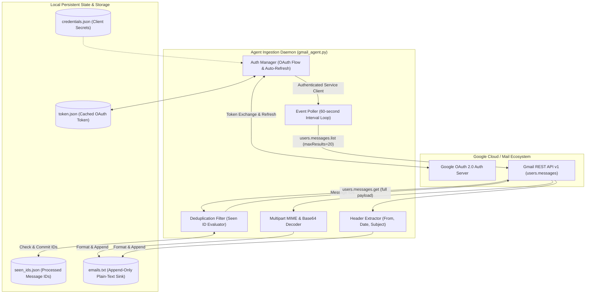

# 📬 Autonomous Gmail Monitor & Ingestion Agent

An autonomous background email ingestion daemon built with **Python 3.11** and the **Google Gmail REST API v1**, designed to monitor inbox events, parse complex multipart MIME payloads, extract metadata, and maintain idempotent state to prevent duplicate processing.

---

## 🏛️ High-Level Design Architecture



---

## 📸 Key Features

- **OAuth 2.0 with Auto-Refresh:** Initial interactive token grant, followed by silent automated token refreshes via `token.json` for persistent unattended execution.
- **Idempotent Ingestion & Deduplication:** Tracks processed message IDs in `seen_ids.json` across sessions, ensuring exactly-once processing even across restarts or crashes.
- **Multipart MIME Decoding:** Recursively parses email payload hierarchies and decodes URL-safe Base64 encoded plain-text bodies.
- **Scheduled Background Polling:** Monitors the inbox with configurable interval loops (default: 60 seconds) with graceful exception recovery.

---

## 🛠️ Tech Stack

- **Python 3.11**
- **Google Client Libraries:** `google-api-python-client`, `google-auth-httplib2`, `google-auth-oauthlib`
- **MIME & Encoding:** `base64`, `email`
- **Storage:** JSON state store, append-only plain-text archive sink

---

## 🚀 Getting Started

### 1. Clone the repository
```bash
git clone https://github.com/jagadishkeertana/gmail-agent.git
cd gmail-agent
```

### 2. Set up virtual environment
```bash
python -m venv venv
# Windows:
venv\Scripts\activate
# Linux/macOS:
source venv/bin/activate
```

### 3. Install dependencies
```bash
pip install -r requirements.txt
```

### 4. Configure Google Cloud Credentials
1. Go to the [Google Cloud Console](https://console.cloud.google.com/).
2. Create a project and enable the **Gmail API**.
3. Configure the OAuth Consent Screen and create **OAuth 2.0 Client ID** credentials (Desktop Application).
4. Download the JSON credentials and place them in the project root as `credentials.json`.

### 5. Run the Agent
```bash
python gmail_agent.py
```
*On first launch, a browser window will open to authenticate. Subsequent executions will use the refreshed `token.json` automatically.*

---

## 📁 Repository Layout

```
gmail-agent/
├── gmail_agent.py        # Main polling daemon and MIME parser
├── credentials.json      # Google Cloud OAuth client secrets (gitignored)
├── token.json            # Cached OAuth access & refresh tokens (gitignored)
├── seen_ids.json         # Processed message ID tracker (gitignored)
├── emails.txt            # Extracted plain-text email sink (gitignored)
├── requirements.txt      # Dependency manifest
├── .gitignore            # Security exclusions for tokens and archives
└── README.md             # Project documentation and HLD
```

---

## 👩‍💻 Author

Built by Keertana
